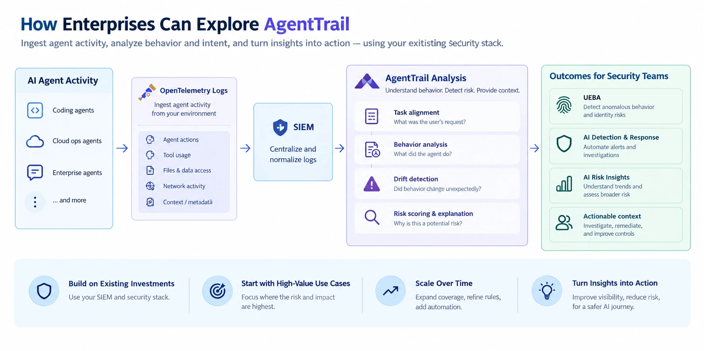

# Beyond AI Agent Monitoring: Detecting Intent Drift and Behavioral Risk

AI agents are moving beyond answering questions. They can read files, write code, call APIs, access cloud environments, and take actions on our behalf.

But as these agents become more autonomous, an important security question emerges:

**How do we know whether an AI agent is doing what we asked it to do—or something else?**

I've been exploring this question through a side project called AgentTrail, and it has led me to think about a broader opportunity for enterprise security teams.

## The challenge: Activity alone doesn't tell the whole story

Imagine asking an AI coding agent to fix a failing test. It reads project files and starts working as expected.

But a file contains untrusted instructions that redirect the agent toward a different task. The agent begins accessing sensitive credentials or attempting to send data to an unfamiliar destination.

Traditional security controls remain important. They help determine what the agent can access and which actions it can perform. But permissions and activity logs alone may not explain whether the agent's behavior still aligns with the original task.

The opportunity is to connect what the agent was asked to do, what it actually did, and what may have caused its behavior to change.

## What if we could analyze intent alongside activity?

This is the idea behind AgentTrail.

Rather than asking only, "Is this action suspicious?", we can also ask:

* **Task alignment:** Does the agent's behavior align with the user's request?
* **Behavior analysis:** Which tools, files, resources, and services is it interacting with?
* **Intent drift:** Has its behavior changed unexpectedly, particularly after encountering untrusted instructions or external content?
* **Risk insights:** What evidence supports the concern, and why should a security analyst investigate?

The goal isn't to flag every unusual action. It is to identify potentially risky deviations, explain them in context, and help security teams decide what to do next.

## How could enterprises explore this approach?

Organizations wouldn't necessarily need to start with a separate security platform. They could explore the approach using their existing security infrastructure.

One possible path is to ingest OpenTelemetry-formatted events from AI agent activity into an existing SIEM, where those events can be correlated with other available security telemetry.

Depending on the instrumentation and data available, agent events could capture tool usage, file and data access, network activity, execution context, and other relevant metadata. The analysis layer could then evaluate behavioral patterns, apply detection rules, look for potential intent drift, and generate evidence-backed risk insights.

The diagram below illustrates one possible enterprise architecture and set of outcomes—not a validated or production-ready implementation.

This approach could complement several familiar security capabilities:

* **UEBA (User and Entity Behavior Analytics):** Extend behavioral analysis to AI agents and their interactions, where sufficient identity and activity context is available.
* **AI Detection & Response:** Identify suspicious agent behavior, support investigations, and potentially trigger response workflows through existing security tools.
* **AI Risk Insights:** Help security teams understand patterns across agents, identify recurring risk scenarios, and prioritize areas for improvement.
* **Evidence-backed investigations:** Connect relevant events into a narrative that explains what happened, why it may be concerning, and what analysts should examine next.

These are potential directions, not capabilities that AgentTrail currently delivers end to end.

## From visibility to action

For enterprises, the opportunity goes beyond detecting a single suspicious event.

A practical adoption path could evolve in stages:

1. **Establish visibility:** Collect and normalize available agent activity in the existing security stack.
2. **Detect behavioral deviations:** Apply rules and behavioral analysis to identify activity that appears inconsistent with the task or established patterns.
3. **Add context and prioritization:** Correlate events, explain the potential risk, and help analysts distinguish meaningful signals from noise.
4. **Connect to response workflows:** Integrate findings with existing investigation and response processes, with automation or approval controls where appropriate.
5. **Expand coverage:** Evaluate additional agent types, environments, and use cases as detection quality and telemetry coverage improve.

The key is to validate detection quality, false-positive rates, and the availability of reliable task context before relying on these insights for automated response.

## The bigger picture

AgentTrail is an initial prototype exploring behavioral analysis, potential intent drift, risk scoring, and evidence-backed explanations using synthetic AI coding-agent sessions. It is not yet connected to live agent activity.

The broader idea, however, is relevant beyond this prototype. AI coding assistants, cloud operations agents, and enterprise workflow agents are all examples of systems where understanding an agent's actions in context could become increasingly important.

For those interested in the product requirements, proposed technical approach and source code:

* [Product Requirements Document (PRD)](https://github.com/ranjitharaj12/AgentTrail/blob/main/docs/PRD.md) — the problem, use cases, goals, and requirements.
* [High-Level System Design](https://github.com/ranjitharaj12/AgentTrail/blob/main/docs/SYSTEM_DESIGN.md) — the proposed architecture and analysis approach.
* [AgentTrail on GitHub](https://github.com/ranjitharaj12/AgentTrail) — the source code for the prototype.

As enterprises adopt more autonomous AI agents, security will need to go beyond knowing what an agent accessed or executed. It will also need better ways to understand whether those actions make sense in the context of the task.

I'd love to hear from security practitioners, SIEM teams, and AI platform builders: How are you approaching AI agent behavioral monitoring today? And where do you see the biggest gaps—in visibility, detection, risk prioritization, or response?
