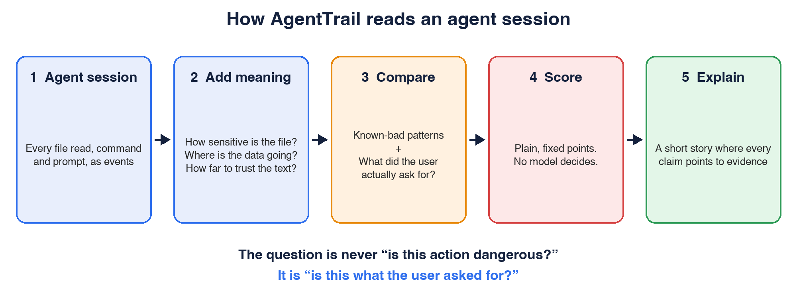

# When an AI agent crosses the line, would you know?

Stories keep surfacing of AI agents doing things they were never asked to do: touching files outside their task, using access nobody meant to give them, or acting on instructions hidden in the content they read. These are not exotic attacks. They are what happens when software with real access works toward an open-ended goal.

I kept asking myself one question: if an agent crossed a boundary on my machine, would I even know?

## Why this is hard

Security teams already watch what people and service accounts do. That approach breaks down with agents:

- **An agent looks like you.** When it reads your AWS credentials, the log looks the same as when you do.
- **Its job is open-ended.** "Fix this bug" can touch dozens of files. Strict allow-lists either get in the way or miss things.
- **It can be talked into things.** A README or web page can hide instructions that quietly redirect the agent. You never typed anything, but its goal has changed.
- **Nobody reads the logs.** There are hundreds of lines per session, and we only look after something goes wrong.

Reading a credentials file is fine in one session and a problem in another. So the real question is not "is this action dangerous?" It is **"is this what the user asked for?"**

## What I built

I started a side project called AgentTrail. It takes what an agent did in a session and checks it against what the user asked for.

It works in five steps:

1. **Collect** every prompt, file read and command.
2. **Add meaning.** How sensitive is this file? Where is the data going? Did the text come from something I can trust?
3. **Compare** against known-bad patterns, and against what the user actually asked for.
4. **Score** the session with fixed, simple rules, so every point traces back to a specific event.
5. **Explain** in a short story where every claim points back to the evidence. If a claim can't be backed up, it gets rejected.

## Where this fits in enterprise AI security

The idea is not tied to coding agents. Any agent with access to files, systems or data raises the same question, and it maps onto things security teams already do:

- **UEBA for agents.** Learn what normal looks like for an agent in a given project, and flag the first time it reaches somewhere new. The twist is that "normal" is defined by what the user asked, not only by history.
- **AI detection and response (AIDR).** Rules and signals for agent behavior, such as credential access, data leaving to a new destination, or a sudden change of direction right after the agent read untrusted content.
- **AI risk insights.** A session-level risk score and a readable explanation, so an analyst can triage in minutes instead of reading raw logs.

The part I find most useful across all three is the "unprompted course change": the agent reads something untrusted, then does something the user never asked for. It needs no keyword list, and it points at the content that likely caused it.

## What I learned

**Intent beats danger.** Once I treated "what did the user ask for?" as the main input, a lot of design choices got simpler.

**Show the evidence.** An alert nobody can verify gets ignored. Every score and every claim in the explanation links to the events behind it.

**Treat everything an agent reads as hostile.** Even my own screens defang links, so a planted URL can't be clicked.

## Where it stands

It's a prototype running on synthetic sessions, not real agent traffic. The next step is to feed it a real agent's activity and see what breaks.

If you work on agent security or observability, I'd love to hear what you'd want flagged first.
